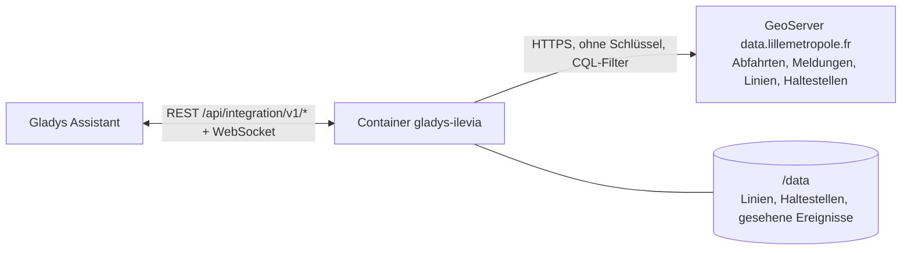
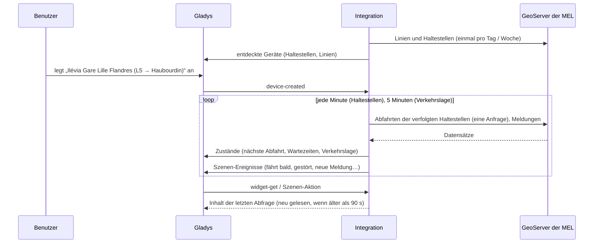
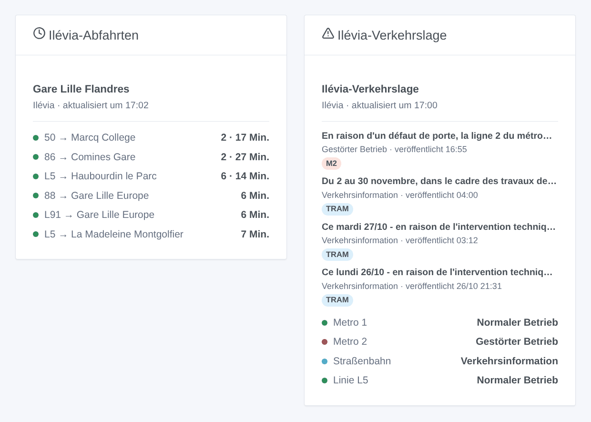

# Gladys Ilévia

[English](README.md) · [Français](README.fr.md) · **Deutsch** · [Español](README.es.md)

[](LICENSE)
[](https://github.com/William-De71/gladys-ilevia/releases)
[](https://github.com/William-De71/gladys-ilevia/actions/workflows/release.yml)
[](https://gladysassistant.com)


Externe [Gladys Assistant](https://gladysassistant.com)-Integration für **Ilévia**, das Bus-, Metro- und Straßenbahnnetz von Lille: die nächsten Busabfahrten in Echtzeit an deinen Haltestellen und die Verkehrslage deiner Linien, mit Szenen und Dashboard-Widgets. Sie liest die offiziellen Open Data von Ilévia, die die Métropole Européenne de Lille veröffentlicht, ohne Konto und ohne Schlüssel.

Benutzerdokumentation: [English](docs/en.md) · [Français](docs/fr.md) · [Deutsch](docs/de.md) · [Español](docs/es.md).

> Community-Integration, weder mit Ilévia, Keolis Lille Métropole noch der Métropole Européenne de Lille verbunden oder von ihnen unterstützt.

## Funktionen

- **Ein Gerät pro verfolgter Haltestelle** (drei im Formular, bis zu 20 weitere über die Schaltfläche **Haltestelle hinzufügen**), per Name eingegeben — alle Straßenseiten, unter allen Namen, die die Daten ihr geben — oder per Code — eine Seite — und gefiltert nach **Linie** und **Richtung**: nächste Abfahrt, Wartezeit der nächsten zwei Abfahrten.
- **Ein Gerät pro verfolgter Linie**, Bus, Metro oder Straßenbahn (höchstens sechs): ihre Verkehrslage (normal, Verkehrsinformation, gestört) und die aktuellen Meldungen von Ilévia.
- **4 Szenen-Auslöser**, **2 Szenen-Aktionen** und **2 Dashboard-Widgets** (siehe unten).
- Alle verfolgten Haltestellen in **einer Anfrage** gelesen, standardmäßig jede Minute (30 s bis 5 Min., nachts alle 10 Min., wenn nichts angekündigt ist), die Verkehrslage alle 5 Minuten; Linien und Haltestellen des Netzes in `/data` gespeichert.
- Konfigurationsschaltflächen: Verbindung testen, Haltestelle suchen (genaue Namen, Codes, Linien und Ziele jeder Straßenseite), Haltestellen hinzufügen / entfernen / auflisten, Diagnose.
- Vier Sprachen überall: Englisch, Französisch, Deutsch, Spanisch.

Was die Open Data von Ilévia nicht enthalten und die Integration nicht erfindet: **keine Abfahrten der Metro** (verfolge die Metrolinien für ihre Verkehrslage), **Straßenbahnabfahrten nur, wenn Ilévia sie veröffentlicht** (keine am 27. Oktober 2026) und **keine Fahrplanzeit, also keine Verspätung**.

## Funktionsweise




Beim Start liest die Integration die Linien (`couleurs_lignes`) und die Haltestellen (`physical_stop`) des Netzes, dazu einmal alle Abfahrten, um die anderen Namen der Haltestellen („V. D’ASCQ PONT DE BOIS“ für „PONT DE BOIS“) und die Codes der Ersatzbusse für die Straßenbahn zu lernen. Dann löst sie auf, was du eingegeben hast: „M1“ ist die Metrolinie ME1, „tram“ die Linie 71, „Gare Lille Flandres“ alle Straßenseiten dieses Namens, „LIG115“ eine davon. Danach liest sie die Abfahrten aller verfolgten Haltestellen in einer Anfrage (`prochains_passages`, auf dem Server nach Haltestellencode gefiltert) in ihrem eigenen Takt und behält die der gewählten Linie und Richtung; alle 5 Minuten liest sie die Verkehrsmeldungen (`perturbations`). Jede Abfrage wird mit der vorigen verglichen, um die Szenen auszulösen.

Zwei Eigenheiten der Daten werden behandelt: Die Uhrzeiten sind Pariser Ortszeiten mit einem „Z“ (die Integration prüft das gegen die echte UTC-Zeit jeder Antwort), und eine Verkehrsmeldung bleibt einen Tag, ohne zu sagen, wann eine Störung vorbei ist (eine Störung gilt 90 Minuten lang als aktuell, sofern keine neuere Meldung zur Linie sie ersetzt).



### Transport

Nur Cloud (`"transports": ["cloud"]`): Der Katalog zeigt das Cloud-Abzeichen. Die Integration kontaktiert `data.lillemetropole.fr`; nur die verfolgten Haltestellen werden abgefragt. Es gibt keine lokale Alternative, also keine Schaltfläche „Lokale Verbindung bevorzugen“.

## Geräte und Funktionen

| Gerät                              | Funktion                          | Kategorie / Typ              | Werte                                       |
| ---------------------------------- | --------------------------------- | ---------------------------- | ------------------------------------------- |
| Ilévia \<Haltestelle\>             | Nächste Abfahrt                   | `text` / `text`              | „L5 → Haubourdin le Parc · 6 Min.“          |
| Ilévia \<Haltestelle\>             | Wartezeit, Wartezeit der nächsten | `duration` / `integer`       | 0 … 180 Min.                                |
| Ilévia Linie / Metro / Straßenbahn | Verkehrslage                      | `text` / `text`              | „Gestörter Betrieb: En raison d’un défaut…“ |
| Ilévia Linie / Metro / Straßenbahn | Aktuelle Verkehrsmeldungen        | `counter-sensor` / `integer` | 0 … 20                                      |

Nachts, ohne Abfahrt, behalten die Wartezeiten ihren letzten Wert (eine 0 würde einen Bus jetzt ankündigen).

## Szenen-Auslöser, Aktionen und Widgets



**Szenen-Auslöser** (einmal pro Übergang; die erste Abfrage dient als Referenz und löst nichts aus):

- **Bus fährt bald**: Eine Abfahrt an einer verfolgten Haltestelle fährt in 2, 3, 5, 10, 15 oder 20 Minuten. Filter: Haltestelle, Minuten.
- **Linie gestört**: Ilévia veröffentlicht eine Störungsmeldung zu einer verfolgten Linie. Filter: Linie.
- **Keine Störung mehr**: Ihre letzte Meldung ist keine aktuelle Störung mehr. Filter: Linie.
- **Neue Verkehrsmeldung**: Ilévia veröffentlicht eine Meldung zu einer verfolgten Linie. Filter: Linie, Art (Information, Störung).

**Szenen-Aktionen**: **nächste Abfahrten** einer Haltestelle (Linie, Ziel, Wartezeit, Uhrzeit, die folgende, ein Satz) und **Verkehrslage einer Linie** (Zustand, Meldungen, letzte Meldung, ein Satz).

**Widgets**: **Ilévia-Abfahrten** (eine verfolgte Haltestelle, mehrere in einer Liste oder eine beliebige in den Einstellungen eingegebene Haltestelle) und **Ilévia-Verkehrslage** (die verfolgten Linien, die eingegebenen oder standardmäßig Metro und Straßenbahn).

Beispiele:

- Wenn **die L5 Richtung Haubourdin in 5 Minuten an Gare Lille Flandres abfährt** → die Flurlampe grün einschalten.
- Wenn **die Metro 1 gestört ist** → `{{triggerEvent.data.summary}}` aufs Handy schicken.
- Werktags um 7:30 Uhr → **die nächsten Abfahrten** deiner Haltestelle lesen und die `summary` vom Küchenlautsprecher ansagen lassen.

## Voraussetzungen

- Gladys Assistant **5.3.0** oder neuer (Widgets und Szenen-Auslöser externer Integrationen, Katalog-Schlüsselwörter und -Länder von Gladys 5.3). Ältere Instanzen können die Integration nicht installieren.
- Sonst nichts: Die Open Data von Ilévia brauchen weder Konto noch Schlüssel.

## Installation

- **Aus dem Store** von Gladys (Integrationen → Externe Integrationen), mit einem Klick, sobald indexiert.
- **Über die URL des Repositorys**: `https://github.com/William-De71/gladys-ilevia`.
- **Entwicklermodus**: Image lokal bauen (`docker build -t gladys-ilevia .`) und aus Gladys installieren.

## Konfiguration

| Feld                     | Beschreibung                                                                                     |
| ------------------------ | ------------------------------------------------------------------------------------------------ |
| Haltestelle (1 bis 3)    | Ein Name („Gare Lille Flandres“) für alle Straßenseiten oder ein Code („LIG115“) für eine Seite. |
| Linie                    | „L5“, „50“, „CO1“. Leer: alle Linien der Haltestelle.                                            |
| Richtung                 | Wörter des Ziels: „Haubourdin“, „Comines \| Halluin“. Leer: beide.                               |
| Verfolgte Linien         | Höchstens sechs, durch Kommas getrennt: „M1, M2, tram, L1“.                                      |
| Abfrage der Haltestellen | 30 s, 1 Min. (Standard), 2 Min. oder 5 Min.                                                      |
| Sprache der Texte        | Gerätenamen, Szenen-Zusammenfassungen und -Ausgaben.                                             |

Schaltflächen: **Verbindung testen**, **Haltestelle suchen** (genaue Namen, Codes, Linien und Ziele jeder Straßenseite), **Haltestelle hinzufügen**, **Haltestelle entfernen**, **Haltestellen auflisten** (die Haltestellen über die drei des Formulars hinaus, in der Gladys-Konfiguration gespeichert) und **Diagnose** (schreibt Haltestellen, Linien, letzte Abfahrten, Fehler und Anfragen in den Tab Protokolle).

## Verwendung

1. Gib eine bis drei Haltestellen ein — mehr über **Haltestelle hinzufügen** — (mit Linie und Richtung, wenn du willst) und die zu verfolgenden Linien, dann speichern.
2. Lege im Tab **Entdecken** die Geräte „Ilévia …“ an.
3. Füge die Widgets **Ilévia-Abfahrten** und **Ilévia-Verkehrslage** einem Dashboard hinzu und baue Szenen mit den Auslösern oben.

## Entwicklung

```bash
npm install
npm test                       # node --test, berührt nie das Netzwerk
npm run lint && npm run format:check
npx github:GladysAssistant/integration-store . --skip-image-check
scripts/build-cover.sh         # cover.jpg aus docs/assets/cover.svg
docs/illustrations/render.sh   # docs/assets/widgets.<Sprache>.png
node .github/scripts/release.mjs next
```

Lokal liest das SDK `GLADYS_HOST_API_URL`, `GLADYS_INTEGRATION_TOKEN` und `GLADYS_INTEGRATION_SELECTOR`; `ILEVIA_API_URL` richtet die Integration auf eine andere Collections-Wurzel (ein Mock); `DEBUG=gladys-integration-sdk` zeigt die SDK-Logs und prüft jeden Widget-Inhalt. Die Tests nutzen echte, gekürzte Antworten des GeoServers der MEL (`test/fixtures/`, Licence Ouverte). Die Regeln des Projekts stehen in [CLAUDE.md](CLAUDE.md).

## Release-Prozess


Jeder Merge auf `main` startet die CI und berechnet dann die Version aus den [Conventional Commits](https://www.conventionalcommits.org/) seit dem letzten Tag: `feat` → Minor, `fix` / `perf` → Patch, `!` oder `BREAKING CHANGE` → Major (ein Minor unter 1.0.0); `docs`, `chore`, `ci`, `test`, `style`, `refactor`, `build` allein veröffentlichen nichts. Der Changelog-Abschnitt wird erzeugt, der Tag gepusht, das Multi-Architektur-Image gebaut, dann erhält `main` den Release-Commit, die GitHub Release wird erstellt und ein letzter Job prüft das öffentliche Image, den Store-Validator und das Topic.

- Der Titel des Pull Requests wird zum Squash-Commit und dann zur Changelog-Zeile: Schreibe ihn auf Englisch, für den Benutzer (`pr-title.yml` prüft ihn). Bearbeite `CHANGELOG.md` nie von Hand.
- 1.0.0 ist eine Entscheidung: Actions → Release → Run workflow mit `release-as: 1.0.0`. `dry-run` zeigt Version und Notizen, ohne zu veröffentlichen.
- **Geschützter Branch**: Die Release pusht ihren Commit mit `GITHUB_TOKEN` auf `main`. Mit einem Ruleset auf `main`, das strenger ist als „kein Löschen, kein Force-Push“, füge GitHub Actions zur Bypass-Liste hinzu (oder pushe über eine GitHub App), sonst schlägt der Veröffentlichungsjob mit Anweisungen fehl.
- Mache nach der ersten Release das `ghcr.io`-Paket öffentlich (Package settings → Change visibility), sonst kann Gladys es nicht laden.

## Fehlerbehebung

Siehe [docs/de.md](docs/de.md#fehlerbehebung). Melde Probleme mit den Versionen von Gladys und der Integration, der betroffenen Haltestelle oder Linie und den Zeilen der Schaltfläche **Diagnose**.

## Mitwirken

Issues und Pull Requests sind willkommen. Führe `npm run format:check && npm run lint && npm test` aus, bevor du einen Pull Request öffnest, und lass alle externen IDs und gespeicherten Schlüssel unverändert (siehe [CLAUDE.md](CLAUDE.md)).

## Sicherheit

Siehe [SECURITY.md](SECURITY.md): Melde Schwachstellen privat. Die Integration braucht kein Geheimnis: Sie liest nur öffentliche Open Data und läuft schreibgeschützt, ohne Root-Rechte, in ihrem Container.

## Kommende Screenshots

Die Bilder oben sind Illustrationen, keine Screenshots. Echte Screenshots kommen in `docs/assets/screenshots/` (PNG, 1280 × 800): `configuration.png`, `discovery.png`, `device.png`, `scene.png`.

## Lizenz

[Apache License 2.0](LICENSE) — siehe auch [NOTICE](NOTICE). Die Abfahrten, Linien, Haltestellen und Verkehrsmeldungen sind Open Data von Ilévia, veröffentlicht von der Métropole Européenne de Lille unter der [Licence Ouverte 2.0](https://www.etalab.gouv.fr/licence-ouverte-open-licence/) (Quelle: MEL – Ilévia): Die Widgets zeigen die Quelle und die Zeit jeder Abfrage. Danke an die Dokumentation und das SDK von Gladys und an die MEL für die Veröffentlichung dieser Daten in Echtzeit.
