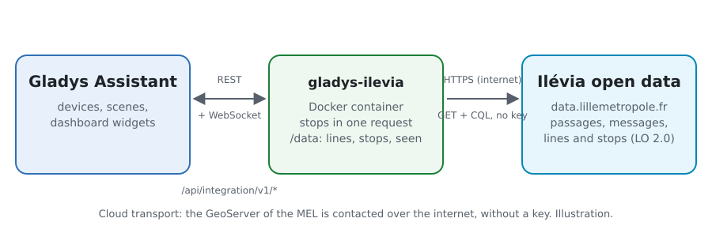
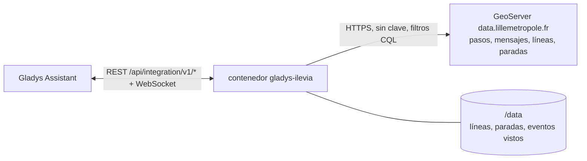
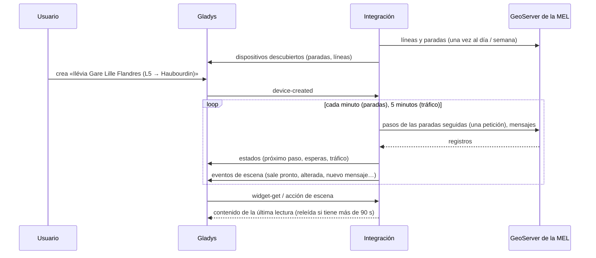
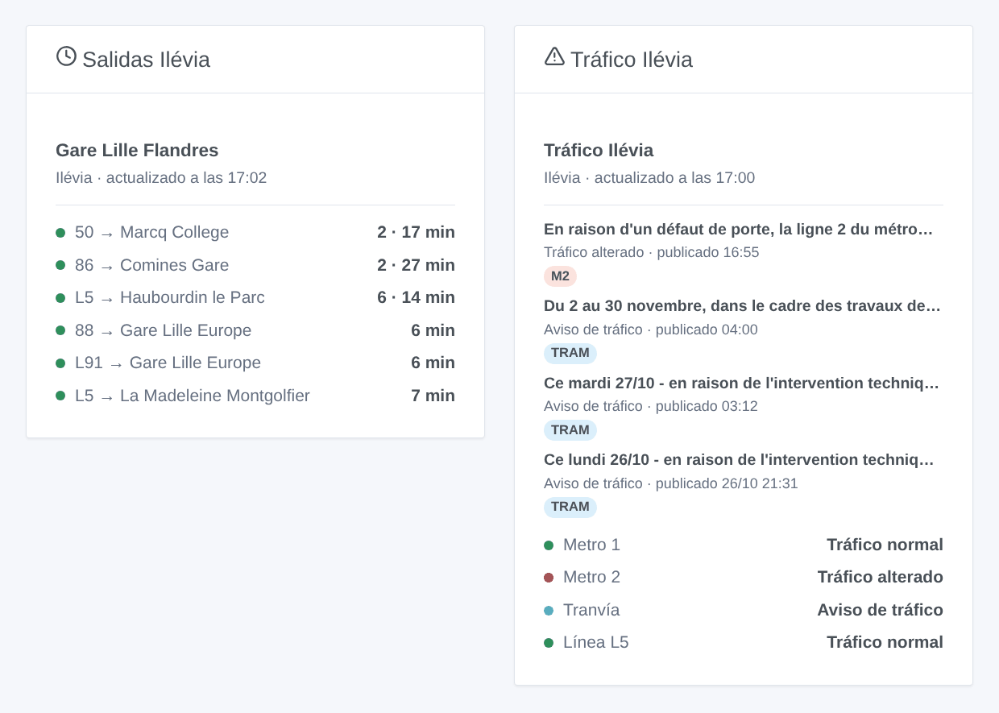

# Gladys Ilévia

[English](README.md) · [Français](README.fr.md) · [Deutsch](README.de.md) · **Español**

[](LICENSE)
[](https://github.com/William-De71/gladys-ilevia/releases)
[](https://github.com/William-De71/gladys-ilevia/actions/workflows/release.yml)
[](https://gladysassistant.com)


Integración externa de [Gladys Assistant](https://gladysassistant.com) para **Ilévia**, la red de autobuses, metro y tranvía de Lille: los próximos pasos de los autobuses en tiempo real en tus paradas y el tráfico de tus líneas, con escenas y widgets del panel. Lee los datos abiertos oficiales de Ilévia publicados por la Métropole Européenne de Lille, sin cuenta ni clave.

Documentación de usuario: [English](docs/en.md) · [Français](docs/fr.md) · [Deutsch](docs/de.md) · [Español](docs/es.md).

> Integración comunitaria, sin afiliación ni respaldo de Ilévia, Keolis Lille Métropole ni la Métropole Européenne de Lille.

## Funciones

- **Un dispositivo por parada seguida** (tres en el formulario, hasta 20 más con el botón **Añadir una parada**), escrita por nombre — todos los lados de la calle, con todos los nombres que le dan los datos — o por código — un solo lado — y filtrada por **línea** y **dirección**: próximo paso, espera de los dos próximos pasos.
- **Un dispositivo por línea seguida**, autobús, metro o tranvía (seis como máximo): su tráfico (normal, aviso de tráfico, alterado) y los mensajes de Ilévia en curso.
- **4 desencadenantes de escena**, **2 acciones de escena** y **2 widgets** (abajo).
- Todas las paradas seguidas leídas en **una sola petición**, cada minuto por defecto (de 30 s a 5 min, cada 10 min de noche cuando no se anuncia nada), el tráfico cada 5 minutos; líneas y paradas de la red guardadas en `/data`.
- Botones de configuración: probar la conexión, buscar una parada (nombres exactos, códigos, líneas y destinos de cada lado de la calle), añadir / quitar / listar paradas, diagnóstico.
- Cuatro idiomas en todas partes: inglés, francés, alemán, español.

Lo que los datos abiertos de Ilévia no contienen, y la integración no se inventa: **ningún paso del metro** (sigue las líneas de metro para su tráfico), **los pasos del tranvía solo cuando Ilévia los publica** (ninguno el 27 de octubre de 2026), y **ningún horario teórico, por tanto ningún retraso**.

## Funcionamiento





Al arrancar, la integración lee las líneas (`couleurs_lignes`) y las paradas (`physical_stop`) de la red, y una vez todos los pasos para aprender los otros nombres de las paradas («V. D’ASCQ PONT DE BOIS» para «PONT DE BOIS») y los códigos de los autobuses que sustituyen al tranvía. Luego resuelve lo que escribiste: «M1» es la línea de metro ME1, «tram» la línea 71, «Gare Lille Flandres» todos los lados de la calle con ese nombre, «LIG115» uno de ellos. Después lee los pasos de todas las paradas seguidas en una petición (`prochains_passages`, filtrados en el servidor por código de parada) a su propio ritmo, y conserva los de la línea y dirección elegidas; cada 5 minutos lee los mensajes de tráfico (`perturbations`). Cada lectura se compara con la anterior para lanzar las escenas.

Se gestionan dos rarezas de los datos: las horas son horas de París escritas con una «Z» (la integración lo comprueba con la hora UTC real de cada respuesta), y un mensaje de tráfico dura un día sin decir cuándo termina una incidencia (una incidencia cuenta como en curso durante 90 minutos, salvo que un mensaje más reciente sobre la línea la sustituya).



### Transporte

Solo cloud (`"transports": ["cloud"]`): el catálogo muestra la insignia cloud. La integración contacta `data.lillemetropole.fr`; solo se piden las paradas seguidas. No hay alternativa local, así que no hay botón «Preferir la conexión local».

## Dispositivos y funciones

| Dispositivo                    | Función                      | Categoría / tipo             | Valores                                    |
| ------------------------------ | ---------------------------- | ---------------------------- | ------------------------------------------ |
| Ilévia \<parada\>              | Próximo paso                 | `text` / `text`              | «L5 → Haubourdin le Parc · 6 min»          |
| Ilévia \<parada\>              | Espera, espera del siguiente | `duration` / `integer`       | 0 … 180 min                                |
| Ilévia línea / metro / tranvía | Tráfico                      | `text` / `text`              | «Tráfico alterado: En raison d’un défaut…» |
| Ilévia línea / metro / tranvía | Avisos de tráfico en curso   | `counter-sensor` / `integer` | 0 … 20                                     |

De noche, sin ningún paso, las esperas conservan su último valor (un 0 anunciaría un autobús ahora).

## Disparadores, acciones de escena y widgets



**Desencadenantes de escena** (una vez por cambio; la primera lectura sirve de referencia y no lanza nada):

- **Autobús en breve**: un paso en una parada seguida sale dentro de 2, 3, 5, 10, 15 o 20 minutos. Filtros: parada, minutos.
- **Línea alterada**: Ilévia publica un mensaje de incidencia sobre una línea seguida. Filtro: línea.
- **Fin de la incidencia**: su último mensaje ya no es una incidencia en curso. Filtro: línea.
- **Nuevo aviso de tráfico**: Ilévia publica un mensaje sobre una línea seguida. Filtros: línea, tipo (información, incidencia).

**Acciones de escena**: **próximos pasos** de una parada (línea, destino, espera, hora, el siguiente, una frase) y **tráfico de una línea** (estado, mensajes, último mensaje, una frase).

**Widgets**: **Salidas Ilévia** (una parada seguida, varias en una lista, o cualquier parada escrita en los ajustes) y **Tráfico Ilévia** (las líneas seguidas, las escritas, o el metro y el tranvía por defecto).

Ejemplos:

- Cuando **la L5 hacia Haubourdin sale de Gare Lille Flandres dentro de 5 minutos** → encender la lámpara de la entrada en verde.
- Cuando **el metro 1 está alterado** → enviar `{{triggerEvent.data.summary}}` a tu teléfono.
- Cada día laborable a las 7:30 → **leer los próximos pasos** de tu parada y hacer que el altavoz de la cocina diga el `summary`.

## Requisitos

- Gladys Assistant **5.3.0** o posterior (widgets y desencadenantes de escena de las integraciones externas, palabras clave y países del catálogo de Gladys 5.3). Las instancias más antiguas no pueden instalar la integración.
- Nada más: los datos abiertos de Ilévia no piden cuenta ni clave.

## Instalación

- **Desde la tienda** de Gladys (Integraciones → Integraciones externas), con un clic, una vez indexada.
- **Desde la URL del repositorio**: `https://github.com/William-De71/gladys-ilevia`.
- **Modo desarrollador**: construye la imagen en local (`docker build -t gladys-ilevia .`) e instálala desde Gladys.

## Configuración

| Campo                  | Descripción                                                                                          |
| ---------------------- | ---------------------------------------------------------------------------------------------------- |
| Parada (1 a 3)         | Un nombre («Gare Lille Flandres») para todos los lados de la calle, o un código («LIG115») para uno. |
| Línea                  | «L5», «50», «CO1». Vacío: todas las líneas de la parada.                                             |
| Dirección              | Palabras del destino: «Haubourdin», «Comines \| Halluin». Vacío: ambos.                              |
| Líneas seguidas        | Hasta seis, separadas por comas: «M1, M2, tram, L1».                                                 |
| Lectura de las paradas | 30 s, 1 min (por defecto), 2 min o 5 min.                                                            |
| Idioma de los textos   | Nombres de los dispositivos, resúmenes y salidas de las escenas.                                     |

Botones: **Probar la conexión**, **Buscar una parada** (nombres exactos, códigos, líneas y destinos de cada lado de la calle), **Añadir una parada**, **Quitar una parada**, **Listar las paradas** (las paradas más allá de las tres del formulario, guardadas en la configuración de Gladys) y **Diagnóstico** (escribe las paradas, líneas, últimos pasos, errores y peticiones en la pestaña Registros).

## Uso

1. Escribe de una a tres paradas — más con **Añadir una parada** — (con su línea y dirección si quieres) y las líneas que seguir, y guarda.
2. En la pestaña **Descubrir**, crea los dispositivos «Ilévia …».
3. Añade los widgets **Salidas Ilévia** y **Tráfico Ilévia** a un panel, y crea escenas con los desencadenantes de arriba.

## Desarrollo

```bash
npm install
npm test                       # node --test, nunca toca la red
npm run lint && npm run format:check
npx github:GladysAssistant/integration-store . --skip-image-check
scripts/build-cover.sh         # cover.jpg desde docs/assets/cover.svg
docs/illustrations/render.sh   # docs/assets/widgets.<idioma>.png
node .github/scripts/release.mjs next
```

En local, el SDK lee `GLADYS_HOST_API_URL`, `GLADYS_INTEGRATION_TOKEN` y `GLADYS_INTEGRATION_SELECTOR`; `ILEVIA_API_URL` apunta la integración a otra raíz de colecciones (una maqueta); `DEBUG=gladys-integration-sdk` muestra los registros del SDK y comprueba cada contenido de widget. Las pruebas usan respuestas reales del GeoServer de la MEL, reducidas (`test/fixtures/`, Licence Ouverte). Las reglas del proyecto están en [CLAUDE.md](CLAUDE.md).

## Proceso de publicación


Cada fusión en `main` lanza la CI y luego calcula la versión a partir de los [Conventional Commits](https://www.conventionalcommits.org/) desde la última etiqueta: `feat` → menor, `fix` / `perf` → parche, `!` o `BREAKING CHANGE` → mayor (una menor antes de 1.0.0); `docs`, `chore`, `ci`, `test`, `style`, `refactor`, `build` solos no publican nada. Se genera la sección del changelog, se sube la etiqueta, se construye la imagen multiarquitectura, luego `main` recibe el commit de publicación, se crea la GitHub Release y un último job comprueba la imagen pública, el validador de la tienda y el topic.

- El título de la pull request se convierte en el commit squash y luego en la línea del changelog: escríbelo en inglés, para el usuario (`pr-title.yml` lo comprueba). No edites nunca `CHANGELOG.md` a mano.
- La 1.0.0 es una decisión: Actions → Release → Run workflow con `release-as: 1.0.0`. `dry-run` muestra la versión y las notas sin publicar.
- **Rama protegida**: la publicación sube su commit a `main` con `GITHUB_TOKEN`. Con un ruleset en `main` más estricto que «sin borrado, sin force-push», añade GitHub Actions a su lista de excepciones (o sube mediante una GitHub App); si no, el job de publicación falla con instrucciones.
- Tras la primera publicación, haz público el paquete de `ghcr.io` (Package settings → Change visibility), o Gladys no podrá descargarlo.

## Solución de problemas

Consulta [docs/es.md](docs/es.md#solución-de-problemas). Informa de los problemas con las versiones de Gladys y de la integración, la parada o línea afectada y las líneas del botón **Diagnóstico**.

## Contribuir

Los issues y pull requests son bienvenidos. Ejecuta `npm run format:check && npm run lint && npm test` antes de abrir una pull request, y no cambies ningún identificador externo ni clave guardada (ver [CLAUDE.md](CLAUDE.md)).

## Seguridad

Consulta [SECURITY.md](SECURITY.md): informa de las vulnerabilidades en privado. La integración no necesita ningún secreto: solo lee datos abiertos públicos, y se ejecuta en solo lectura, sin root, en su contenedor.

## Capturas pendientes

Las imágenes de arriba son ilustraciones, no capturas de pantalla. Las capturas reales irán en `docs/assets/screenshots/` (PNG, 1280 × 800): `configuration.png`, `discovery.png`, `device.png`, `scene.png`.

## Licencia

[Licencia Apache 2.0](LICENSE) — ver también [NOTICE](NOTICE). Los pasos, líneas, paradas y mensajes de tráfico son datos abiertos de Ilévia publicados por la Métropole Européenne de Lille bajo la [Licence Ouverte 2.0](https://www.etalab.gouv.fr/licence-ouverte-open-licence/) (fuente: MEL – Ilévia): los widgets muestran la fuente y la hora de cada lectura. Gracias a la documentación y al SDK de Gladys, y a la MEL por publicar estos datos en tiempo real.
