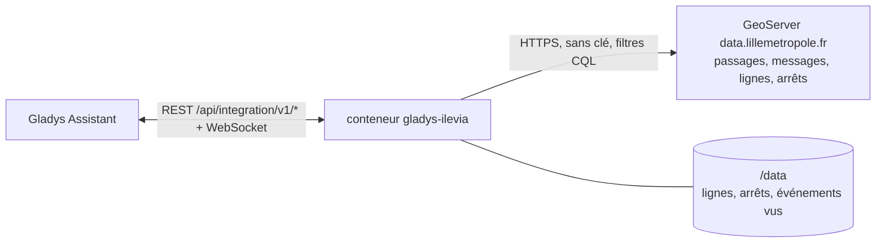
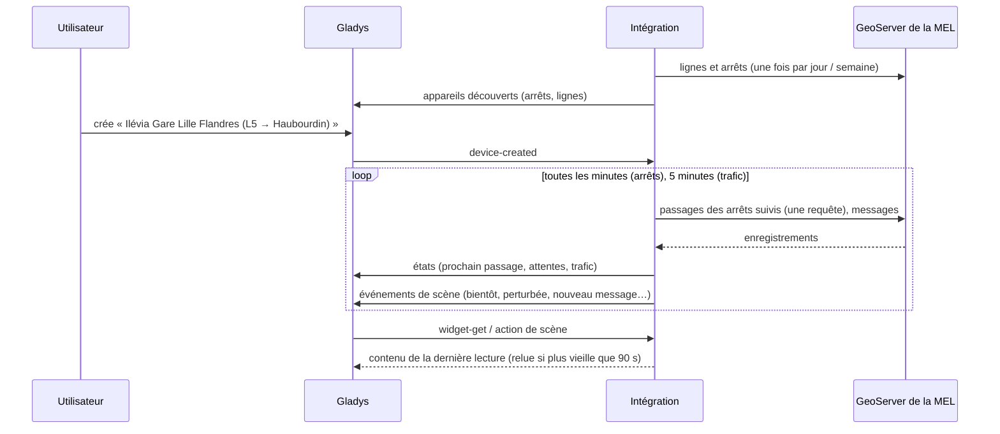
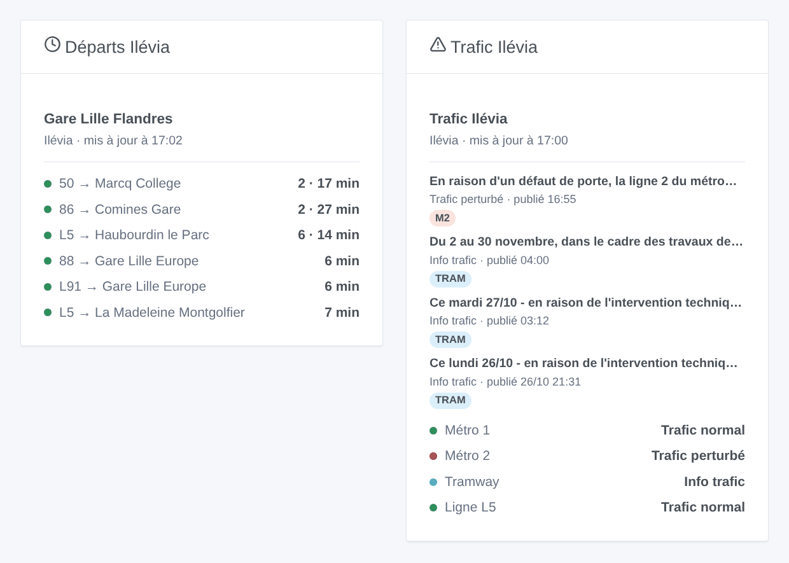

# Gladys Ilévia

[English](README.md) · **Français** · [Deutsch](README.de.md) · [Español](README.es.md)

[](LICENSE)
[](https://github.com/William-De71/gladys-ilevia/releases)
[](https://github.com/William-De71/gladys-ilevia/actions/workflows/release.yml)
[](https://gladysassistant.com)


Intégration externe [Gladys Assistant](https://gladysassistant.com) pour **Ilévia**, le réseau de bus, de métro et de tram de Lille : les prochains passages des bus en temps réel à vos arrêts et le trafic de vos lignes, avec scènes et widgets de tableau de bord. Elle lit l’open data officiel d’Ilévia publié par la Métropole Européenne de Lille, sans compte ni clé.

Documentation utilisateur : [English](docs/en.md) · [Français](docs/fr.md) · [Deutsch](docs/de.md) · [Español](docs/es.md).

> Intégration communautaire, ni affiliée ni approuvée par Ilévia, Keolis Lille Métropole ou la Métropole Européenne de Lille.

## Fonctionnalités

- **Un appareil par arrêt suivi** (trois dans le formulaire, jusqu’à 20 de plus avec le bouton **Ajouter un arrêt**), saisi par nom — tous les côtés de la rue, sous tous les noms que lui donnent les données — ou par code — un seul côté — et filtré par **ligne** et **direction** : prochain passage, attente des deux prochains passages.
- **Un appareil par ligne suivie**, bus, métro ou tram (six au plus) : son trafic (normal, info trafic, perturbé) et les messages d’Ilévia en cours.
- **4 déclencheurs de scène**, **2 actions de scène** et **2 widgets** (ci-dessous).
- Tous les arrêts suivis lus en **une seule requête**, toutes les minutes par défaut (30 s à 5 min, toutes les 10 min la nuit quand rien n’est annoncé), le trafic toutes les 5 minutes ; lignes et arrêts du réseau gardés dans `/data`.
- Boutons de configuration : tester la connexion, chercher un arrêt (noms exacts, codes, lignes et destinations de chaque côté de la rue), ajouter / retirer / lister les arrêts, diagnostic.
- Quatre langues partout : anglais, français, allemand, espagnol.

Ce que l’open data d’Ilévia ne contient pas, et que l’intégration n’invente pas : **pas de passages du métro** (suivez les lignes de métro pour leur trafic), **les passages du tram seulement quand Ilévia les publie** (aucun le 27 octobre 2026), et **pas d’horaire théorique, donc pas de retard**.

## Fonctionnement




Au démarrage, l’intégration lit les lignes (`couleurs_lignes`) et les arrêts (`physical_stop`) du réseau, plus une fois tous les passages pour apprendre les autres noms des arrêts (« V. D’ASCQ PONT DE BOIS » pour « PONT DE BOIS ») et les codes des bus qui remplacent le tram. Elle retrouve ensuite ce que vous avez saisi : « M1 » est la ligne de métro ME1, « tram » la ligne 71, « Gare Lille Flandres » tous les côtés de la rue de ce nom, « LIG115 » l’un d’eux. Puis elle lit les passages de tous les arrêts suivis en une requête (`prochains_passages`, filtrés sur le serveur par code d’arrêt) à son propre rythme, et garde ceux de la ligne et de la direction choisies ; toutes les 5 minutes, elle lit les messages trafic (`perturbations`). Chaque lecture est comparée à la précédente pour déclencher les scènes.

Deux bizarreries des données sont gérées : les heures sont des heures de Paris écrites avec un « Z » (l’intégration le vérifie contre l’heure UTC réelle de chaque réponse), et un message trafic reste un jour sans dire quand l’incident est fini (un incident compte comme en cours pendant 90 minutes, sauf si un message plus récent sur la ligne le remplace).



### Transport

Cloud uniquement (`"transports": ["cloud"]`) : le catalogue affiche le badge cloud. L’intégration contacte `data.lillemetropole.fr` ; seuls les arrêts suivis sont demandés. Il n’y a pas d’alternative locale, donc pas de bouton « Préférer la connexion locale ».

## Appareils et fonctionnalités

| Appareil                       | Fonctionnalité              | Catégorie / type             | Valeurs                                      |
| ------------------------------ | --------------------------- | ---------------------------- | -------------------------------------------- |
| Ilévia \<arrêt\>               | Prochain passage            | `text` / `text`              | « L5 → Haubourdin le Parc · 6 min »          |
| Ilévia \<arrêt\>               | Attente, attente du suivant | `duration` / `integer`       | 0 … 180 min                                  |
| Ilévia ligne / métro / tramway | Trafic                      | `text` / `text`              | « Trafic perturbé : En raison d’un défaut… » |
| Ilévia ligne / métro / tramway | Infos trafic en cours       | `counter-sensor` / `integer` | 0 … 20                                       |

La nuit, sans aucun passage, les attentes gardent leur dernière valeur (un 0 annoncerait un bus maintenant).

## Déclencheurs, actions et widgets



**Déclencheurs de scène** (une fois par changement ; la première lecture sert de référence et ne déclenche rien) :

- **Bus bientôt** : un passage à un arrêt suivi part dans 2, 3, 5, 10, 15 ou 20 minutes. Filtres : arrêt, minutes.
- **Ligne perturbée** : Ilévia publie un message de perturbation sur une ligne suivie. Filtre : ligne.
- **Fin de perturbation** : son dernier message n’est plus un incident en cours. Filtre : ligne.
- **Nouveau message trafic** : Ilévia publie un message sur une ligne suivie. Filtres : ligne, type (information, perturbation).

**Actions de scène** : **prochains passages** d’un arrêt (ligne, destination, attente, heure, le suivant, une phrase) et **trafic d’une ligne** (état, messages, dernier message, une phrase).

**Widgets** : **Départs Ilévia** (un arrêt suivi, plusieurs dans une même liste, ou n’importe quel arrêt saisi dans les réglages) et **Trafic Ilévia** (les lignes suivies, celles saisies, ou le métro et le tram par défaut).

Exemples :

- Quand **la L5 vers Haubourdin part de Gare Lille Flandres dans 5 minutes** → allumer la lampe de l’entrée en vert.
- Quand **le métro 1 est perturbé** → envoyer `{{triggerEvent.data.summary}}` sur votre téléphone.
- Chaque jour de semaine à 7 h 30 → **lire les prochains passages** de votre arrêt et faire dire le `summary` par l’enceinte de la cuisine.

## Prérequis

- Gladys Assistant **5.3.0** ou plus récent (widgets et déclencheurs de scène des intégrations externes, mots-clés et pays du catalogue de Gladys 5.3). Les instances plus anciennes ne peuvent pas installer l’intégration.
- Rien d’autre : l’open data d’Ilévia ne demande ni compte ni clé.

## Installation

- **Depuis le store** de Gladys (Intégrations → Intégrations externes), en un clic, une fois indexée.
- **Depuis l’URL du dépôt** : `https://github.com/William-De71/gladys-ilevia`.
- **Mode développeur** : construisez l’image en local (`docker build -t gladys-ilevia .`) et installez-la depuis Gladys.

## Configuration

| Champ              | Description                                                                                           |
| ------------------ | ----------------------------------------------------------------------------------------------------- |
| Arrêt (1 à 3)      | Un nom (« Gare Lille Flandres ») pour tous les côtés de la rue, ou un code (« LIG115 ») pour un côté. |
| Ligne              | « L5 », « 50 », « CO1 ». Vide : toutes les lignes de l’arrêt.                                         |
| Direction          | Des mots de la destination : « Haubourdin », « Comines \| Halluin ». Vide : les deux.                 |
| Lignes suivies     | Six au plus, séparées par des virgules : « M1, M2, tram, L1 ».                                        |
| Lecture des arrêts | 30 s, 1 min (par défaut), 2 min ou 5 min.                                                             |
| Langue des textes  | Noms des appareils, résumés et sorties des scènes.                                                    |

Boutons : **Tester la connexion**, **Chercher un arrêt** (noms exacts, codes, lignes et destinations de chaque côté de la rue), **Ajouter un arrêt**, **Retirer un arrêt**, **Lister les arrêts** (les arrêts au-delà des trois du formulaire, gardés dans la configuration de Gladys) et **Diagnostic** (écrit les arrêts, lignes, derniers passages, erreurs et requêtes dans l’onglet Journaux).

## Utilisation

1. Saisissez un à trois arrêts — plus avec **Ajouter un arrêt** — (avec leur ligne et leur direction si vous voulez) et les lignes à suivre, puis enregistrez.
2. Dans l’onglet **Découvrir**, créez les appareils « Ilévia … ».
3. Ajoutez les widgets **Départs Ilévia** et **Trafic Ilévia** à un tableau de bord, et créez des scènes avec les déclencheurs ci-dessus.

## Développement

```bash
npm install
npm test                       # node --test, ne touche jamais le réseau
npm run lint && npm run format:check
npx github:GladysAssistant/integration-store . --skip-image-check
scripts/build-cover.sh         # cover.jpg depuis docs/assets/cover.svg
docs/illustrations/render.sh   # docs/assets/widgets.<langue>.png
node .github/scripts/release.mjs next
```

En local, le SDK lit `GLADYS_HOST_API_URL`, `GLADYS_INTEGRATION_TOKEN` et `GLADYS_INTEGRATION_SELECTOR` ; `ILEVIA_API_URL` pointe l’intégration vers une autre racine de collections (une maquette) ; `DEBUG=gladys-integration-sdk` affiche les journaux du SDK et vérifie chaque contenu de widget. Les tests utilisent de vraies réponses du GeoServer de la MEL, réduites (`test/fixtures/`, Licence Ouverte). Les règles du projet sont dans [CLAUDE.md](CLAUDE.md).

## Processus de release


Chaque fusion sur `main` lance la CI, puis calcule la version à partir des [Conventional Commits](https://www.conventionalcommits.org/) depuis le dernier tag : `feat` → mineure, `fix` / `perf` → correctif, `!` ou `BREAKING CHANGE` → majeure (une mineure avant 1.0.0) ; `docs`, `chore`, `ci`, `test`, `style`, `refactor`, `build` seuls ne publient rien. La section du changelog est générée, le tag poussé, l’image multi-architecture construite, puis `main` reçoit le commit de release, la GitHub Release est créée et un dernier job vérifie l’image publique, le validateur du store et le topic.

- Le titre de la pull request devient le commit squash, puis la ligne du changelog : écrivez-le en anglais, pour l’utilisateur (`pr-title.yml` le vérifie). Ne modifiez jamais `CHANGELOG.md` à la main.
- La 1.0.0 est une décision : Actions → Release → Run workflow avec `release-as: 1.0.0`. `dry-run` montre la version et les notes sans rien publier.
- **Branche protégée** : la release pousse son commit sur `main` avec `GITHUB_TOKEN`. Avec un ruleset sur `main` plus strict que « pas de suppression, pas de force-push », ajoutez GitHub Actions à sa liste de contournement (ou poussez via une GitHub App), sinon le job de publication échoue avec des instructions.
- Après la première release, rendez le package `ghcr.io` public (Package settings → Change visibility), sinon Gladys ne peut pas le télécharger.

## Dépannage

Voir [docs/fr.md](docs/fr.md#dépannage). Signalez les problèmes avec les versions de Gladys et de l’intégration, l’arrêt ou la ligne concernés, et les lignes du bouton **Diagnostic**.

## Contribuer

Issues et pull requests bienvenues. Lancez `npm run format:check && npm run lint && npm test` avant d’ouvrir une pull request, et gardez inchangés tous les identifiants externes et clés stockées (voir [CLAUDE.md](CLAUDE.md)).

## Sécurité

Voir [SECURITY.md](SECURITY.md) : signalez les vulnérabilités en privé. L’intégration n’a besoin d’aucun secret : elle ne lit que des données publiques, et tourne en lecture seule, sans être root, dans son conteneur.

## Captures à venir

Les images ci-dessus sont des illustrations, pas des captures d’écran. Les vraies captures iront dans `docs/assets/screenshots/` (PNG, 1280 × 800) : `configuration.png`, `discovery.png`, `device.png`, `scene.png`.

## Licence

[Licence Apache 2.0](LICENSE) — voir aussi [NOTICE](NOTICE). Les passages, lignes, arrêts et messages trafic sont l’open data d’Ilévia publié par la Métropole Européenne de Lille sous [Licence Ouverte 2.0](https://www.etalab.gouv.fr/licence-ouverte-open-licence/) (source : MEL – Ilévia) : les widgets affichent la source et l’heure de chaque lecture. Merci à la doc et au SDK de Gladys, et à la MEL de publier ces données en temps réel.
