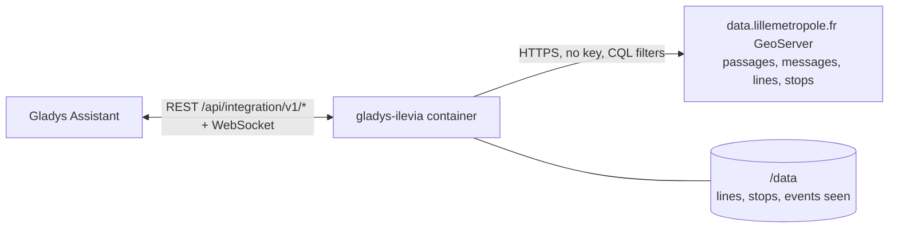
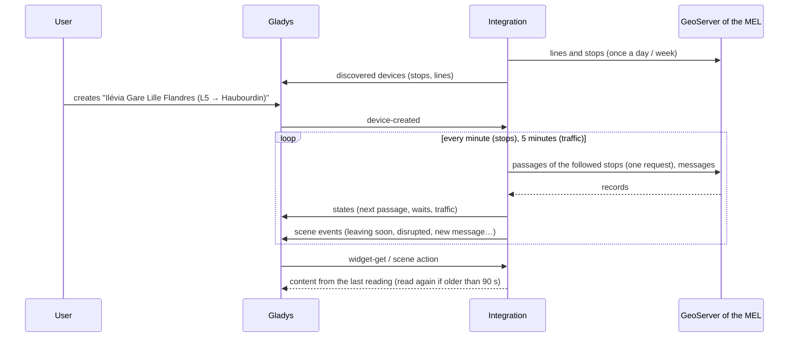
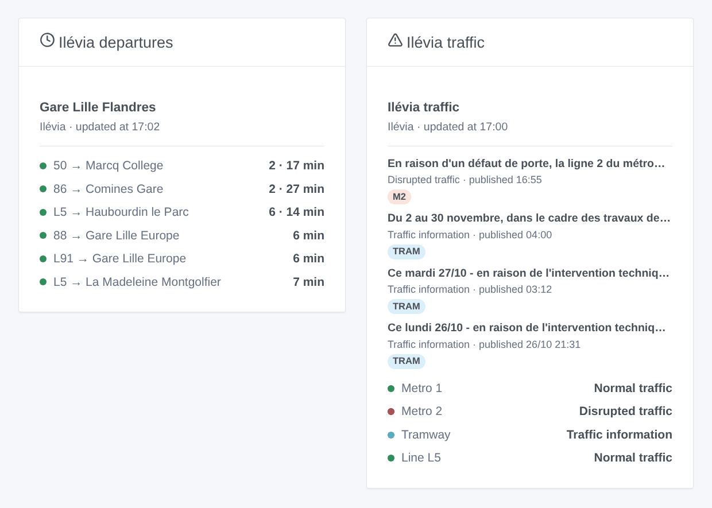

# Gladys Ilévia

**English** · [Français](README.fr.md) · [Deutsch](README.de.md) · [Español](README.es.md)

[](LICENSE)
[](https://github.com/William-De71/gladys-ilevia/releases)
[](https://github.com/William-De71/gladys-ilevia/actions/workflows/release.yml)
[](https://gladysassistant.com)


[Gladys Assistant](https://gladysassistant.com) external integration for **Ilévia**, the bus, metro and tram network of Lille: the next bus passages in real time at your stops and the traffic of your lines, with scenes and dashboard widgets. It reads the official open data of Ilévia published by the Métropole Européenne de Lille, without an account or a key.

User documentation: [English](docs/en.md) · [Français](docs/fr.md) · [Deutsch](docs/de.md) · [Español](docs/es.md).

> Community integration, not affiliated with nor endorsed by Ilévia, Keolis Lille Métropole or the Métropole Européenne de Lille.

## Features

- **One device per followed stop** (three in the form, up to 20 more with the **Add a stop** button), typed by name — every side of the street, under every name the data give it — or by code — one side — and filtered by **line** and **direction**: next passage, wait of the next two passages.
- **One device per followed line**, bus, metro or tram (up to six): its traffic (normal, traffic information, disrupted) and the messages of Ilévia under way.
- **4 scene triggers**, **2 scene actions** and **2 dashboard widgets** (below).
- Every followed stop read in **one request**, every minute by default (30 s to 5 min, every 10 min at night when nothing is announced), traffic every 5 minutes; lines and stops of the network kept in `/data`.
- Configuration buttons: test the connection, find a stop (exact names, codes, lines and destinations of each side of the street), add / remove / list stops, diagnostic.
- Four languages everywhere: English, French, German, Spanish.

What the open data of Ilévia do not hold, and the integration does not make up: **no metro passages** (follow the metro lines for their traffic), **tram passages only when Ilévia publishes them** (none on 27 October 2026), and **no timetable time, hence no delay**.

## How it works




At start, the integration reads the lines (`couleurs_lignes`) and the stops (`physical_stop`) of the network, plus every passage once to learn the other names of the stops ("V. D'ASCQ PONT DE BOIS" for "PONT DE BOIS") and the codes of the buses replacing the tram. It then resolves what you typed: "M1" is the metro line ME1, "tram" the line 71, "Gare Lille Flandres" every side of the street of that name, "LIG115" one of them. Then it reads the passages of every followed stop in one request (`prochains_passages`, filtered on the server by stop code) on its own timer, and keeps the ones of the chosen line and direction; every 5 minutes it reads the traffic messages (`perturbations`). Each reading is compared with the previous one to fire the scene triggers.

Two quirks of the data are handled: the times are Paris wall-clock times written with a "Z" (the integration checks it against the true UTC time of each answer), and a traffic message stays a day without saying when an incident is over (an incident counts as under way for 90 minutes, unless a newer message about the line replaces it).



### Transport

Cloud only (`"transports": ["cloud"]`): the catalog shows the cloud badge. The integration contacts `data.lillemetropole.fr`; only the followed stops are asked. There is no local alternative, so there is no "prefer the local connection" button.

## Devices and features

| Device                        | Feature                      | Category / type              | Values                                      |
| ----------------------------- | ---------------------------- | ---------------------------- | ------------------------------------------- |
| Ilévia \<stop\>               | Next passage                 | `text` / `text`              | "L5 → Haubourdin le Parc · 6 min"           |
| Ilévia \<stop\>               | Wait, wait for the following | `duration` / `integer`       | 0 … 180 min                                 |
| Ilévia line / metro / tramway | Traffic                      | `text` / `text`              | "Disrupted traffic: En raison d'un défaut…" |
| Ilévia line / metro / tramway | Traffic messages under way   | `counter-sensor` / `integer` | 0 … 20                                      |

At night, without any passage, the waits keep their last value (a 0 would announce a bus now).

## Scene triggers, actions and widgets



**Scene triggers** (once per transition; the first reading is a reference and fires nothing):

- **Bus leaving soon**: a passage at a followed stop leaves in 2, 3, 5, 10, 15 or 20 minutes. Filters: stop, minutes.
- **Line disrupted**: Ilévia publishes an incident message ("Perturbation") about a followed line. Filter: line.
- **No incident any more**: its latest message is no longer an incident under way. Filter: line.
- **New traffic message**: Ilévia publishes a message about a followed line. Filters: line, kind (information, incident).

**Scene actions**: **next passages** of a stop (line, destination, wait, time, the following one, a sentence) and **traffic of a line** (state, messages, latest message, a sentence).

**Widgets**: **Ilévia departures** (a followed stop, several in one list, or any stop typed in the settings) and **Ilévia traffic** (the followed lines, the ones typed, or the metro and the tram by default).

Examples:

- When **the L5 towards Haubourdin leaves Gare Lille Flandres in 5 minutes** → light the hall lamp in green.
- When **metro 1 is disrupted** → send `{{triggerEvent.data.summary}}` to your phone.
- Every weekday at 7:30 → **read the next passages** of your stop and have the `summary` spoken by the kitchen speaker.

## Requirements

- Gladys Assistant **5.3.0** or later (widgets and scene triggers of external integrations, catalog keywords and countries of Gladys 5.3). Older instances cannot install the integration.
- Nothing else: the open data of Ilévia need neither an account nor a key.

## Installation

- **From the store** of Gladys (Integrations → External integrations), in one click, once indexed.
- **From the repository URL**: `https://github.com/William-De71/gladys-ilevia`.
- **Developer mode**: build the image locally (`docker build -t gladys-ilevia .`) and install it from Gladys.

## Configuration

| Field                 | Description                                                                                     |
| --------------------- | ----------------------------------------------------------------------------------------------- |
| Stop (1 to 3)         | A name ("Gare Lille Flandres") for every side of the street, or a code ("LIG115") for one side. |
| Line                  | "L5", "50", "CO1". Empty: every line of the stop.                                               |
| Direction             | Words of the destination: "Haubourdin", "Comines \| Halluin". Empty: both.                      |
| Followed lines        | Up to six, separated by commas: "M1, M2, tram, L1".                                             |
| Reading of the stops  | 30 s, 1 min (default), 2 min or 5 min.                                                          |
| Language of the texts | Device names, scene summaries and outputs.                                                      |

Buttons: **Test the connection**, **Find a stop** (exact names, codes, lines and destinations of each side of the street), **Add a stop**, **Remove a stop**, **List the stops** (the stops beyond the three of the form, kept in the Gladys configuration) and **Diagnostic** (writes the stops, lines, last passages, errors and requests to the Logs tab).

## Usage

1. Enter one to three stops — more with **Add a stop** — (with their line and direction if you wish) and the lines to follow, then save.
2. In the **Discover** tab, create the "Ilévia …" devices.
3. Add the **Ilévia departures** and **Ilévia traffic** widgets to a dashboard, and build scenes with the triggers above.

## Development

```bash
npm install
npm test                       # node --test, never touches the network
npm run lint && npm run format:check
npx github:GladysAssistant/integration-store . --skip-image-check
scripts/build-cover.sh         # cover.jpg from docs/assets/cover.svg
docs/illustrations/render.sh   # docs/assets/widgets.<lang>.png
node .github/scripts/release.mjs next
```

Locally, the SDK reads `GLADYS_HOST_API_URL`, `GLADYS_INTEGRATION_TOKEN` and `GLADYS_INTEGRATION_SELECTOR`; `ILEVIA_API_URL` points the integration to another collections root (a mock); `DEBUG=gladys-integration-sdk` shows the SDK logs and checks every widget content. The tests use real answers of the GeoServer of the MEL, reduced (`test/fixtures/`, Licence Ouverte). The rules of the project are in [CLAUDE.md](CLAUDE.md).

## Release process


Every merge on `main` runs the CI, then computes the version from the [Conventional Commits](https://www.conventionalcommits.org/) since the last tag: `feat` → minor, `fix` / `perf` → patch, `!` or `BREAKING CHANGE` → major (a minor below 1.0.0); `docs`, `chore`, `ci`, `test`, `style`, `refactor`, `build` alone publish nothing. The changelog section is generated, the tag pushed, the multi-architecture image built, then `main` receives the release commit, the GitHub Release is created and a last job checks the public image, the store validator and the topic.

- The pull request title becomes the squash commit, then the changelog line: write it in English, for the user (`pr-title.yml` checks it). Never edit `CHANGELOG.md` by hand.
- 1.0.0 is a decision: Actions → Release → Run workflow with `release-as: 1.0.0`. `dry-run` shows the version and the notes without publishing.
- **Protected branch**: the release pushes its commit to `main` with `GITHUB_TOKEN`. With a ruleset on `main` stricter than "no deletion, no force-push", add GitHub Actions to its bypass list (or push through a GitHub App), otherwise the publish job fails with instructions.
- After the first release, make the `ghcr.io` package public (Package settings → Change visibility), or Gladys cannot pull it.

## Troubleshooting

See [docs/en.md](docs/en.md#troubleshooting). Report issues with the versions of Gladys and of the integration, the stop or line concerned, and the lines of the **Diagnostic** button.

## Contributing

Issues and pull requests are welcome. Run `npm run format:check && npm run lint && npm test` before opening a pull request, and keep every external id and stored key unchanged (see [CLAUDE.md](CLAUDE.md)).

## Security

See [SECURITY.md](SECURITY.md): report vulnerabilities privately. The integration needs no secret: it only reads public open data, and runs read-only, as a non-root user, in its container.

## Screenshots to come

The images above are illustrations, not screenshots. Real screenshots will go in `docs/assets/screenshots/` (PNG, 1280 × 800): `configuration.png`, `discovery.png`, `device.png`, `scene.png`.

## License

[Apache License 2.0](LICENSE) — see also [NOTICE](NOTICE). The passages, lines, stops and traffic messages are open data of Ilévia published by the Métropole Européenne de Lille under the [Licence Ouverte 2.0](https://www.etalab.gouv.fr/licence-ouverte-open-licence/) (source: MEL – Ilévia): the widgets show the source and the time of each reading. Thanks to the Gladys documentation and SDK, and to the MEL for publishing these data in real time.
